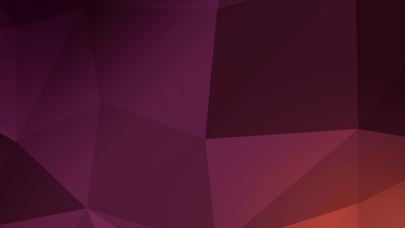
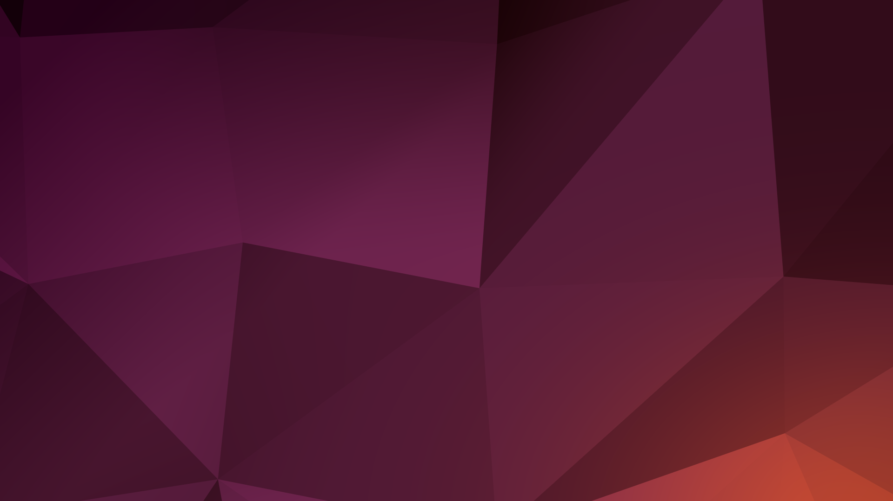
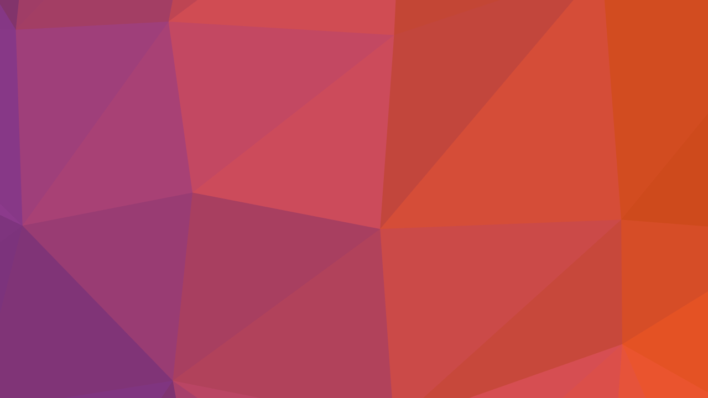

# Low-poly Waves

**An animated desktop background for GNOME:** a slowly rolling low-poly sea in Ubuntu colours. It draws on your GPU inside the compositor and is designed to cost almost nothing.



<sub>The animation above is sped up 4× and scaled down; on the desktop the swells roll by slowly.</sub>

## Features
- **A few big swells** rolling through a mesh of large triangles, in the style of a sci-fi or hacker desktop.
- **Two colour styles:**
  - **Aubergine** (default): the colours of the Ubuntu 24.04 wallpaper, with deep wine-red shadows and an orange glow.
  - **Classic**: the purple-to-orange low-poly look of older Ubuntu releases.
- **Lightweight:** one small GPU shader with a capped frame rate. It pauses automatically when you can't see the desktop.
- **Live settings** for style, speed, triangle size and frame rate.
- **Multi-monitor:** every monitor gets its own animated background.

| Aubergine (default) | Classic |
|---|---|
|  |  |

## Requirements
- **GNOME Shell 50** (tested on Ubuntu 26.04, Wayland session).
- `git`, `bash` and `glib-compile-schemas`, which are present on any normal GNOME desktop.

> **Other GNOME versions:** GNOME only loads extensions that list its version in `metadata.json`. This one lists only `"50"`. You can try a nearby version (for example 49 or 51) by adding it to `"shell-version"` and reinstalling. It is untested there and may log errors.

## Installation
```bash
git clone https://github.com/an-awful-person/animated-desktop-for-gnome.git
cd low-poly-waves
./install.sh
```
Then **log out and log back in**. On Wayland, GNOME Shell only picks up new extensions at login. Your background will start moving a moment after you log in.

`install.sh` copies the extension to `~/.local/share/gnome-shell/extensions/lowpoly-waves@local`, compiles its settings schema and enables it. It does not need root and doesn't touch anything outside your home folder.

## Settings
Open the settings with:
```bash
gnome-extensions prefs lowpoly-waves@local
```
You can also use the **Extensions** app: find *Low-poly Waves* and click the cog. Changes apply immediately.

| Setting | Default | What it does |
|---|---|---|
| Style | Aubergine | *Aubergine*: Ubuntu 24.04 colours. *Classic*: purple to orange. |
| Frame rate | 30 | Maximum redraws per second. Use 10–15 to save even more power; the motion is slow enough that it still looks smooth. |
| Wave speed | 1.0 | How fast the swells roll. |
| Triangle size | 2.5 rows | Rows of triangles over the screen height. Fewer rows give bigger triangles. The size of the waves stays the same. |
| Drift | 0.08 | How much the triangle corners wobble sideways. Set it to 0 for a calmer look. |
| Pause when covered | On | Stops animating a monitor while a maximized or fullscreen window covers it. |

## Performance
The extension doesn't run a separate program or play a video. It attaches one small fragment shader to the desktop background that GNOME Shell already draws:

- **Capped frame rate:** frames are drawn at the configured rate only (30 fps by default), never faster. Each frame re-runs only the shader.
- **Automatic pausing:** a monitor stops animating while a maximized, fullscreen or screen-filling window covers it. Everything pauses while the screen is locked or the Activities overview is open. When nothing is animating, the extension just checks twice a second whether it should resume.
- **Measured cost:** in a test on a 1920×1080 screen at 30 fps, GNOME Shell's CPU use went from about 0.1% to about 3% of one core while the waves were visible. The GPU work is a tiny fraction of a modern graphics card. Your numbers will vary with resolution and hardware.

To check it on your own machine, compare these with the extension enabled and disabled:
```bash
top -p "$(pgrep -x gnome-shell)"   # GNOME Shell CPU usage
nvidia-smi dmon -s pu              # GPU usage and power (NVIDIA cards)
```

## Updating
```bash
cd low-poly-waves
git pull
./install.sh
```
Then log out and back in.

## Uninstalling
```bash
gnome-extensions disable lowpoly-waves@local
rm -r ~/.local/share/gnome-shell/extensions/lowpoly-waves@local
```
Your normal wallpaper comes back as soon as the extension is disabled.

## Troubleshooting
- **Nothing moves after installing:** make sure you logged out and back in. Then check that GNOME sees the extension and that it is enabled:
  ```bash
  gnome-extensions info lowpoly-waves@local
  ```
  The state should be `ACTIVE`. If it says `ERROR` or `OUT OF DATE`, your GNOME version is probably not 50 (see [Requirements](#requirements)).
- **Pausing:** the background is supposed to stand still while a window is maximized or fullscreen, or while the Activities overview is open.
- **Error messages:** GNOME Shell logs them to the journal:
  ```bash
  journalctl -f -o cat /usr/bin/gnome-shell
  ```
- **Your session won't start after installing** (unlikely): switch to a text console with `Ctrl`+`Alt`+`F3`, log in and remove the extension:
  ```bash
  rm -r ~/.local/share/gnome-shell/extensions/lowpoly-waves@local
  ```
  Then switch back with `Ctrl`+`Alt`+`F1` (or `F2`) and log in again.

When reporting a problem, include your GNOME version (`gnome-shell --version`), your distribution and any `lowpoly` lines from the journal.

## Customising the look
All visuals are in one shader: [`shaders/lowpoly.glsl`](shaders/lowpoly.glsl). You can tweak it without logging out by previewing it in a browser:

```bash
python3 tools/make_preview.py   # rebuilds preview.html from the shader
xdg-open preview.html
```
`preview.html` takes URL parameters:
- `?style=aubergine` or `?style=lowpoly` picks the colour style.
- `?rows=2` sets the triangle size.
- `?speed=3` sets the wave speed.
- `?amp=0.05` sets the drift.
- `?t=12` freezes time at 12 seconds, which is handy for screenshots.

When you're happy with the result, run `./install.sh` again and log back in.

### Project layout
| Path | Contents |
|---|---|
| `extension.js` | Attaches the shader to each monitor's background, drives the frame timer and handles pausing. |
| `shaders/lowpoly.glsl` | The look: triangle mesh, swells, both colour styles and shading. |
| `prefs.js` | The settings window. |
| `schemas/` | Settings definitions (GSettings). |
| `metadata.json` | Extension name, ID and supported GNOME versions. |
| `install.sh` | Installs or updates the extension for the current user. |
| `tools/make_preview.py` | Builds `preview.html`, the in-browser preview. |
| `preview.html` | Generated preview page; open it in any browser to see the effect. |
| `docs/` | Screenshots used in this README. |

## License
[GPL-2.0-or-later](LICENSE), the same license as GNOME Shell.
